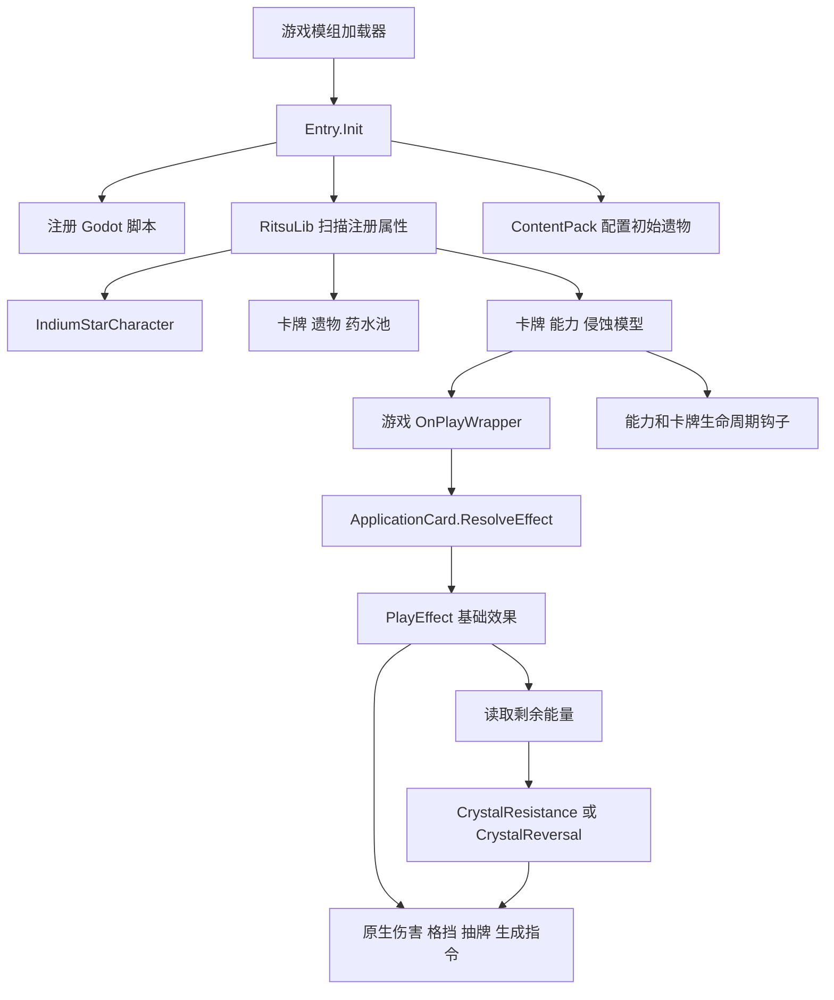

# IndiumStar 架构与代码审查

日期：2026-10-02

审查对象：C:/Users/34773/Desktop/神秘想法/sts2改造/IndiumStar/IndiumStar

结论：项目已有可以继续扩展的角色模组骨架，主要卡牌通过游戏原生指令实现，晶抗和晶逆的基础判定时点符合已确认的规则。不过，核心机制存在自动出牌次数误计、延迟力量错误扣除、永久金币递减未保存等问题。应先修复生命周期和结算衔接，再扩展完整卡池。

本次审查没有修改业务源码。依据包括项目源码、工程配置、双语本地化、用户确认的机制、卡牌文档，以及工作区归档中的游戏本体源码快照。涉及本体流程的结论已与该快照交叉核对，但快照不能代替当前安装游戏的运行验证。

## 审查范围与验证结果

- 阅读了 src 下全部 63 个 C# 文件，共 5664 行，包含说明性注释。
- 发现 41 个注册卡牌模型：37 张主卡牌与 4 种晶化。
- 阅读了 12 个自定义能力、1 个侵蚀模型、角色及三个内容池。
- 检查了全部 10 份本地化 JSON：均可解析；中英文同表键集合一致，格式占位符集合一致，未发现重复键。
- 与卡牌文档中的 52 条主卡牌记录按名称对照，尚有 15 条没有对应实现，其中包括未命名技能和缺少效果的宏枝晶。
- 项目未提供自动化测试或 CI 配置，也没有可用的本机 local.props 或随项目交付的 Directory.Build.props。
- 附带 Release DLL 的元数据显示其引用 .NET 9、GodotSharp 4.5.1 和 RitsuLib.Runtime 0.6.2。它证明存在历史产物，不能证明当前源码可重新构建，亦不能证明实机效果正确。
- 只读 MSBuild 项目解析及路径检查未完成：SDK 解析阶段无法读取本地 NuGet.Config；放开读取的自动审批超时。没有执行完整 Build、PCK 导出或游戏部署。

优先级含义：P1 应在继续扩展卡池前修复；P2 应在对外测试或发布前修复；P3 为可维护性和显示质量改进。以下复现场景是根据源码推导的验收步骤，本次没有宣称它们已在游戏中执行。

## 架构与主要函数

| 文件或函数 | 职责 | 审查结论 |
| --- | --- | --- |
| Entry.Init，Entry.cs:25 | 注册 Godot 脚本与程序集，配置初始遗物 | 入口集中，使用框架正常注册流程 |
| IndiumStarCharacter | 配置生命、金币、角色属性、原版资源回退 | 当前为使用铁甲资源的角色骨架 |
| IndiumStarCardPool | 以 TypeListCardPoolModel 和 RegisterCard 属性收集卡牌 | 添加卡牌主要靠属性注册，无需手写总列表 |
| ApplicationCard.OnPlay / ResolveEffect，ApplicationCard.cs:66 | 先等待基础效果，再读取能量并选分支 | 结算时点正确，分支仅判断一次 |
| ApplicationCard.PlayEffect | 子类实现基础效果，可返回选中的卡牌供分支使用 | 局部返回值避免跨次出牌中转字段残留；返回类型目前只支持 CardModel |
| CrystalResistance / CrystalReversal | 实现可选晶抗、晶逆效果 | 默认空实现，适合普通卡与运用卡复用 |
| ResolveMainEffectOnly，ApplicationCard.cs:96 | 直接重复基础效果 | 不属于完整的游戏重放流程，见 F04 |
| CrystallizationRules.AddToHand | 创建指定类型晶化并加入手牌 | 生成逻辑集中；choiceContext 和 source 参数当前没有被使用 |
| HasPlayedCrystallizationThisTurn | 从战斗历史统计晶化出牌 | 错误包含自动出牌，见 F01 |
| IsCrystallizationCard / IsApplicationCard | 按本地化标题识别牌族 | 把显示文案与战斗规则耦合，后续应改成稳定标记 |
| CardSelectCmd.FromHand / FromCombatPile | 玩家选牌并执行后续操作 | 使用本体选择指令，有助于保留原版选择同步流程 |
| ApplicationCoPower 与 CrystallizeAffliction | 给抽到的卡牌增加晶化标记及效果 | 存在一次性消除和侵蚀槽冲突，见 F06、F07 |
| CharacterizationStrengthPower | 下一回合发放力量、该回合结束扣回 | 叠加后的待发放值与已发放值混用，见 F02 |
| ReminiscenceDrawPower | 本回合统计抽牌，下一回合增加起手抽牌 | 零抽牌路径和显示存在问题，见 F08、F10 |
| ApplicationCuPower | 累计攻击造成的未被格挡伤害，达到阈值加毒 | 清除时点不符合本回合描述，见 F09 |
| CrystalCoin.OnPlay | 发放金币并把递减次数写回牌组原件 | 内存更新成立，存档持久化不成立，见 F03 |
| GasPhaseSurge.AfterFlush / BeforeSideTurnStart | 保留成长与下回合返回手牌 | 能表达跨回合行为；需实际覆盖手牌满、消耗堆及复制场景 |

ApplicationCard 的名字容易被误认为“运用牌族基类”，但分析、表征、基团迁移等也继承它。因此以后不能直接用“是 ApplicationCard”来识别运用牌族，应给牌族另设独立的接口、标签或 ID 集合。

## 应优先修复的问题

### F01 P1 自动打出的晶化占用了手动额度

位置：[CrystallizationRules.cs:72](</C:/Users/34773/Desktop/神秘想法/sts2改造/IndiumStar/IndiumStar/src/Cards/CrystallizationRules.cs:72>)

统计条件只有当前回合、对应玩家、IsFirstInSeries 和晶化牌族，没有排除 IsAutoPlay。IsFirstInSeries 表示一次系列出牌的第一段，自动出牌的第一段同样满足它。

用户确认的规则是自动打出晶化不计入次数。当前实现只是让自动出牌绕过 IsPlayable，却仍把它写入后续手动出牌所使用的历史统计。因此自动出牌自身可以成功，之后手动出牌却被错误禁止。

验收：本回合没有手动打出晶化，使用离析自动打出一张晶化，再尝试手动打出另一张。预期仍可手动打出一次；当前统计会认为额度已用完。

修复方向：统计手动出牌时排除 IsAutoPlay，同时保留玩家、回合和 IsFirstInSeries 限定。验证自动后手动、手动后自动、不同晶化共用额度及下一回合恢复。

本体快照依据：[CardPlay.cs:46](</C:/Users/34773/Desktop/神秘想法/sts2改造/归档_2026-10-02_STS2旧任务/01_工程与参考源码/Slay the Spire 2/src/Core/Entities/Cards/CardPlay.cs:46>) 明确区分自动出牌；[CardModel.cs:1922](</C:/Users/34773/Desktop/神秘想法/sts2改造/归档_2026-10-02_STS2旧任务/01_工程与参考源码/Slay the Spire 2/src/Core/Models/CardModel.cs:1922>) 把该标记和出牌索引分别写入记录。

### F02 P1 表征扣除了尚未发放的力量

位置：[CharacterizationStrengthPower.cs:78](</C:/Users/34773/Desktop/神秘想法/sts2改造/IndiumStar/IndiumStar/src/Powers/CharacterizationStrengthPower.cs:78>)、[CharacterizationStrengthPower.cs:110](</C:/Users/34773/Desktop/神秘想法/sts2改造/IndiumStar/IndiumStar/src/Powers/CharacterizationStrengthPower.cs:110>)

能力使用 Counter 叠加，只有一个 _granted 标记。开始时按当前 Amount 发力量，结束时又按当前 Amount 扣力量。两次之间的新施加会增加 Amount，但不会增加已经发放的力量。

验收：第 N 回合使用表征预约 3 力量；第 N+1 回合开始获得 3 力量；该回合再用表征预约 3 力量。Amount 变为 6，_granted 仍为 true，结束时却扣 6 并删除整个能力。额外扣掉了 3 力量，第 N+2 回合预约也丢失。

修复方向：分别记录已发放的力量和等待下一回合的力量；扣回实际已发放值，保留新的预约，避免一个布尔值承担两个回合的状态。

### F03 P1 晶币的永久递减在存档中丢失

位置：[CrystalCoin.cs:54](</C:/Users/34773/Desktop/神秘想法/sts2改造/IndiumStar/IndiumStar/src/Cards/CrystalCoin.cs:54>)、[CrystalCoin.cs:115](</C:/Users/34773/Desktop/神秘想法/sts2改造/IndiumStar/IndiumStar/src/Cards/CrystalCoin.cs:115>)

_playsThisRun 是普通私有字段，项目没有为它提供 SavedProperty、跑局保存槽或其他序列化路径。写回 DeckVersion 只让当前进程内的牌组原件更新，不能使字段自动进入存档。

验收：晶币在战斗中使用两次，分别获得 18、15 金币；结束战斗并保存退出，再继续游戏。该卡下一次收益应为 12；未恢复递减次数时会回到 18。玩家可以通过重新载入取消收益递减。

修复方向：使用框架支持的可保存卡牌属性或稳定的跑局数据方案，区分各张牌，覆盖使用、升级、复制及存档往返。普通战斗临时字段不应一概视为保存错误，这张牌的“本场游戏永久”才是必须持久化的依据。

本体快照的 [CardModel.ToSerializable](</C:/Users/34773/Desktop/神秘想法/sts2改造/归档_2026-10-02_STS2旧任务/01_工程与参考源码/Slay the Spire 2/src/Core/Models/CardModel.cs:2228>) 通过 SavedProperties 保存注册的属性。[RitsuLib 持久化说明](https://sts2-ritsulib.ritsukage.com/guide/persistence-guide) 提供跑局数据与保存状态机制；具体使用方式应与项目锁定的 0.6.2 版本核对。

## 其他结算和兼容性问题

### F04 P2 自定义重放绕过原版出牌生命周期

位置：[ApplicationCard.cs:96](</C:/Users/34773/Desktop/神秘想法/sts2改造/IndiumStar/IndiumStar/src/Cards/ApplicationCard.cs:96>)、[CrystalFlow.cs:102](</C:/Users/34773/Desktop/神秘想法/sts2改造/IndiumStar/IndiumStar/src/Cards/CrystalFlow.cs:102>)、[ApplicationTh.cs:123](</C:/Users/34773/Desktop/神秘想法/sts2改造/IndiumStar/IndiumStar/src/Cards/ApplicationTh.cs:123>)

直接调用 PlayEffect 能重复伤害、格挡或生成晶化，但不会创建独立 CardPlay，也不会经过出牌历史和 BeforeCardPlayed、AfterCardPlayed 钩子。

例如运用-Th 的一次本次重放可以执行三遍基础效果，但饰带扇按攻击牌出牌数累计时只收到一次外层出牌事件；余像也不能像原版重放一样逐次触发。

这是结算与原版重放的明确差异。如果团队把“重放”定义为原版重放，需要统一接入出牌生命周期，并给不重复晶抗/晶逆的要求单独加抑制机制。如果设计本来只要求重复基础效果，应改用能够表达这个含义的文本，避免与原版术语混用。

本体快照依据：[CardModel.cs:1896](</C:/Users/34773/Desktop/神秘想法/sts2改造/归档_2026-10-02_STS2旧任务/01_工程与参考源码/Slay the Spire 2/src/Core/Models/CardModel.cs:1896>) 的循环对各段重放调用钩子；[OrnamentalFan.cs:101](</C:/Users/34773/Desktop/神秘想法/sts2改造/归档_2026-10-02_STS2旧任务/01_工程与参考源码/Slay the Spire 2/src/Core/Models/Relics/OrnamentalFan.cs:101>) 在 AfterCardPlayed 中计数。

### F05 P2 运用-Pb 的晶抗生成了错误的晶化类型

位置：[ApplicationPb.cs:94](</C:/Users/34773/Desktop/神秘想法/sts2改造/IndiumStar/IndiumStar/src/Cards/ApplicationPb.cs:94>)

代码调用 AddToHand<CrystallizationPb>，但卡牌原文和当前中文描述均为“晶抗：晶化1”。用户已明确：括号没有字符时生成普通晶化。

当前会额外获得具有虚无与随机保留效果的 Pb 晶化。应生成普通晶化，或在设计确实改变时同步文档与卡面为晶化（Pb）1。

### F06 P2 运用-Co 把本回合词条变成了一次性词条

位置：[ApplicationCoPower.cs:90](</C:/Users/34773/Desktop/神秘想法/sts2改造/IndiumStar/IndiumStar/src/Powers/ApplicationCoPower.cs:90>)

标记卡牌第一次打出前就 ClearAffliction。卡牌文本是本回合获得晶化2，而不是本回合下一次打出获得晶化2。

验收：让被标记卡牌获得原版重放，或在同一回合回收并再次打出。预期每次该牌被打出均有晶化词条，当前仅第一次生效。

修复方向：效果标记保留到回合结束，由统一的晶化词条执行路径处理每次有效出牌；若要一次性效果，应明确改变规格。

### F07 P2 运用-Co 不能保证给已侵蚀的卡牌附加词条

位置：[ApplicationCo.cs:96](</C:/Users/34773/Desktop/神秘想法/sts2改造/IndiumStar/IndiumStar/src/Cards/ApplicationCo.cs:96>)

实现借用卡牌唯一的 Affliction 槽来表示额外晶化。在本体快照中，已有另一种侵蚀时 CanAfflict 会返回 false，CardCmd.Afflict 返回 null。调用方未检查结果，仍会给予保留，却没有给予承诺的晶化2。

验收：抽到的第一张牌已带其他侵蚀，再使用运用-Co。核对是否同时获得保留和晶化词条。

修复方向：使用可与原有侵蚀共存的附加状态与显示机制，或者明确并妥善处理不兼容卡牌；仅静默忽略失败不满足任意第一张牌的描述。这里没有把本体已提前拦截的情况误报为必然崩溃。

本体快照依据：[AfflictionModel.cs:200](</C:/Users/34773/Desktop/神秘想法/sts2改造/归档_2026-10-02_STS2旧任务/01_工程与参考源码/Slay the Spire 2/src/Core/Models/AfflictionModel.cs:200>)。

### F08 P2 回忆-钒永的零抽牌路径不结束

位置：[ReminiscenceDrawPower.cs:120](</C:/Users/34773/Desktop/神秘想法/sts2改造/IndiumStar/IndiumStar/src/Powers/ReminiscenceDrawPower.cs:120>)、[ReminiscenceDrawPower.cs:143](</C:/Users/34773/Desktop/神秘想法/sts2改造/IndiumStar/IndiumStar/src/Powers/ReminiscenceDrawPower.cs:143>)

计数回合结束后 _counting 没有关闭；下一回合只有 _carriedDraws 大于0才删除能力。如果本回合因不能抽牌或抽牌堆不足而没有实际抽到牌，该能力会留下并把下一回合的普通抽牌计入，之后又产生不应该存在的回响。

修复方向：统计回合结束时停止统计；兑现回合无论预约数量是否为0都结束本次预约。存在再次施加时，分别维护旧预约和新的本回合统计。

### F09 P2 运用-Cu 的本回合能力晚了一方回合才消失

位置：[ApplicationCuPower.cs:121](</C:/Users/34773/Desktop/神秘想法/sts2改造/IndiumStar/IndiumStar/src/Powers/ApplicationCuPower.cs:121>)

能力挂在敌人身上，以 side == Owner.Side 判断清除时机。因此它在敌人回合结束才移除，而不是描述中的当前玩家回合结束。普通单人流程下常常暂时看不出额外数值，但持续窗口已经不同；额外攻击、其他战斗阶段及后续扩展会观察到这个差异。

修复方向：记录施加方或有效回合边界，根据明确的设计时点清除，不能把目标的所属方直接作为“本回合”的定义。

另外，该能力声明 Counter，但触发次数未使用 Amount，Configure 还会覆盖同一实例的阈值。重复施加以及普通和升级版本混用的规则需要明确：是替换、叠加还是各自计数。

### F10 P3 回忆-钒永的提示数量与实际抽牌数量不同

位置：[ReminiscenceDrawPower.cs:134](</C:/Users/34773/Desktop/神秘想法/sts2改造/IndiumStar/IndiumStar/src/Powers/ReminiscenceDrawPower.cs:134>)、[powers.json:19](</C:/Users/34773/Desktop/神秘想法/sts2改造/IndiumStar/IndiumStar/IndiumStar/localization/zhs/powers.json:19>)

实际额外抽牌使用 _carriedDraws，卡面提示使用 Amount，后者来自施加次数。即使预定额外抽4张，提示也可能仍显示抽1张。需要单独提供实际预约数量的显示参数，并在变化后刷新提示。

### F11 P2 晶化Hs 只增加攻击伤害，没有提供力量状态

位置：[CrystallizationHs.cs:81](</C:/Users/34773/Desktop/神秘想法/sts2改造/IndiumStar/IndiumStar/src/Cards/CrystallizationHs.cs:81>)

实现是在手牌中时对 powered attack 额外加1伤害。它没有改变 StrengthPower 的层数，也没有对力量查询提供等价值。

普通攻击可能表现接近力量，但“具有力量”还会影响力量查询、翻倍与效果计数等机制。例如分析按可见能力计数时不会因为这个光环而多出一个力量效果；原版或其他模组按力量层数结算也看不到该贡献。

修复方向：决定它是否应具有原版力量的完整语义。若是，应统一实现和查询手中光环的力量贡献、叠加与离手移除；若仅是攻击伤害加成，应把文案准确写成该效果。

### F12 P2 构建失败仍可能改动已安装模组

位置：[IndiumStar.csproj:71](</C:/Users/34773/Desktop/神秘想法/sts2改造/IndiumStar/IndiumStar/IndiumStar.csproj:71>)、[IndiumStar.csproj:110](</C:/Users/34773/Desktop/神秘想法/sts2改造/IndiumStar/IndiumStar/IndiumStar.csproj:110>)

顺序是先复制 DLL 和清单到游戏，再复制本地化，再检查或导出 PCK。如果缺少 Godot 或导出失败，Build 报失败，但游戏目录可能已装入新 DLL 和 has_pck=true 的清单。旧 PCK 若保留，会形成新代码与旧文本的混合；没有旧 PCK 时则形成不完整安装。

修复方向：先在项目的 staging 目录构建完整 DLL、清单和 PCK，全部验证成功后再部署；把纯编译、打包和安装拆成明确目标，提供不改动游戏目录的构建模式。

README 声称外部 Directory.Build.props 已关闭 RitsuLibAutoCopy，但本次交付中没有该文件；项目反而设置了 RitsuLibDeployDir。应显式交付或说明该开关，核对干净环境下依赖是否会被自动覆盖，避免依赖开发者个人工作区状态。

## 与卡牌文档的规格差异

这些差异相对于用户提供的 Word 文档；README 的部分描述已经采用了改动后的行为。如果团队曾另行调整设计，需要补充变更依据，统一一份权威规格，不能直接把所有差异当作未经确认的程序错误。

| 卡牌 | 文档规格 | 当前实现 | 定位 |
| --- | --- | --- | --- |
| 运用-中子 | 技能；升级从1费变0费 | 攻击；升级只增加伤害，费用仍1 | [ApplicationNeutron.cs:45](</C:/Users/34773/Desktop/神秘想法/sts2改造/IndiumStar/IndiumStar/src/Cards/ApplicationNeutron.cs:45>)、OnUpgrade:126 |
| 回身踢 | 升级不再消耗 | CanonicalKeywords 始终消耗；升级未移除 | [SpinKick.cs:30](</C:/Users/34773/Desktop/神秘想法/sts2改造/IndiumStar/IndiumStar/src/Cards/SpinKick.cs:30>)、OnUpgrade:91 |
| 运用-Zn | 晶抗失去1点能量 | 晶抗令本牌本场战斗费用增加1 | [ApplicationZn.cs:65](</C:/Users/34773/Desktop/神秘想法/sts2改造/IndiumStar/IndiumStar/src/Cards/ApplicationZn.cs:65>) |
| 碎晶雨 | 升级基础段数3→4，基础每段仍3；晶抗追加伤害3→4 | 共用 DamageVar，升级基础每段也变4；无修正时基础总伤害16而非12 | [ShatterCrystalRain.cs:160](</C:/Users/34773/Desktop/神秘想法/sts2改造/IndiumStar/IndiumStar/src/Cards/ShatterCrystalRain.cs:160>) |

还需明确：运用-Ca 的“下一次卡牌格挡翻倍”是否属于晶抗分支；回忆-钒永重复施加时是否叠加监听收益；运用-Th 的重放是否和晶流一样不触发晶抗/晶逆。文档中晶流明确写了这个例外，运用-Th 没有同样说明，代码却把例外应用于两者。

## 代码质量与改进方向

值得保留的部分：

- 多数效果使用 DamageCmd、CreatureCmd、CardPileCmd、PowerCmd，而非直接改生命、格挡等数值。
- 基础效果和能量分支集中在同一基类；选牌结果通过局部返回值传递。
- 角色、卡牌、能力、池和资源路径分开组织，添加卡牌的入口清晰。
- 晶化-Pb 的随机选择使用游戏 RNG，减少自建随机数造成的状态差异。
- JSON 可以解析，双语键和格式参数对应，基础静态质量较好。

需要改善的部分：

1. 规则身份依赖本地化标题。IsCrystallizationCard 与 IsApplicationCard 应使用稳定标记。改名、新语言或其他模组的同名卡都可能改变玩法判定；显示文本不应成为规则 ID。
2. 每次可打出检查遍历整个战斗出牌历史并读取本地化标题。限额为1时可先用 Any 早停；更完整的方案是维护或查询按玩家、回合筛选的历史。长战斗和大量零费复制牌需要性能验收。
3. 缺少统一的临时、跨回合、整场战斗和整局游戏状态约定。表征与回忆-钒永的问题说明这一点已经影响正确性。
4. 未见自动化测试。应优先覆盖额度、能量判定、延迟状态、原版重放联动和晶币存档，避免只测单张牌在普通场景是否有数值变化。
5. README 存在陈旧片段：仍称只有中子具有晶抗/晶逆、只有一个具名晶化变体，部分构建与回响说明和实现不一致。依赖最低版本与实际安装版本的大小关系也写反：实际安装版本应满足最低版本要求。
6. 工程允许 unsafe，但当前业务源码没有使用 unsafe；可移除不必要的设置以保持工程意图清晰。
7. ApplicationEffectKeys.cs 是已废弃的注释文件，部分参数和 Configure 参数已经不再使用，后续可清理。
8. 需要记录实际测试的游戏版本、RitsuLib 版本、Godot 版本及发布包校验值。min_game_version 与历史 DLL 的程序集版本不能提供完整的兼容性证明。

## 实现进度

37 张主卡牌有名称对应的源码；4 种晶化为普通、Mg、Hs、Pb。Nb 和 U 晶化还没有实现。

文档中尚无对应实现的条目：

- 未命名普通技能、晶簇枪、宏枝晶。
- 运用-Nb、回忆-污染O、回忆-污染H、回忆-硬钙石、量子点、延拓展延。
- 崩碎之歌、运用-U、密铺形态、回忆-锡疑、嬗变、回忆-磷语。

当前没有注册的能力牌模型。量子点同时触发两分支，以及污染H按晶抗触发次数结算等机制也还没有统一事件接口。接入这些能力牌时，需要显式区分“满足能量条件”和“实际触发了该牌的晶抗效果”，不能只把空分支调用次数当作触发次数。

遗物与药水的完整性未计入本次评价，符合当前专注卡牌的范围。

## 建议修复顺序与验收

1. 修复 F01、F02、F03，先保证额度、延迟力量与整局保存成立。
2. 统一重放与动态晶化词条的结算约定，处理 F04、F06、F07。
3. 修复 Pb 类型、回响零路径、Cu 时长与显示语义。
4. 核对四组文档差异，确定卡牌设计的权威版本。
5. 拆分构建与部署，完成干净环境的编译、打包和实机加载。
6. 在基础机制稳定后补全能力牌和稀有卡。

最小验收应包括：

| 范围 | 必须覆盖的场景 |
| --- | --- |
| 晶抗和晶逆 | 基础效果结束时0与非0能量；基础效果返还能量；分支扣能量后不重新选择 |
| 晶化额度 | 自动后手动、手动后自动、不同变体共用额度、下一回合恢复 |
| 延迟状态 | 多张表征同回合施加；发放回合再次预约；回响实际抽牌为0；再次施加 |
| 重放 | 原版出牌钩子、饰带扇与余像等联动；晶抗/晶逆抑制范围 |
| 动态晶化 | 同一被标记牌多次打出；已有另一侵蚀；回合结束清理 |
| 永久状态 | 晶币使用后的保存退出与继续；升级后的收益；多张牌分别递减 |
| 发布 | 完整 DLL 与 PCK 同版；导出失败不改游戏安装；指定版本实机加载 |

本报告的验证边界：已完成源码阅读、静态交叉核对、JSON 与元数据检查；未确认重新编译通过，未执行游戏内验收。只读项目检查的权限申请因自动审批超时而未执行，超时不表示该操作被认定为不安全。

